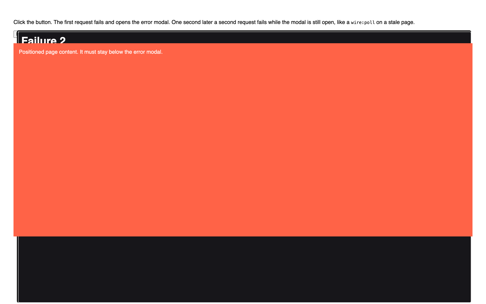

# Livewire error modal ends up below the page after a second failed request

Minimal reproduction for Livewire 4.4.8 on Laravel 13.

When a Livewire request fails, Livewire shows the response in `<dialog id="livewire-error">` opened with `showModal()`. If another request fails while that dialog is open, `showHtmlModal()` reuses the dialog and moves it with `document.body.prepend(modal)`. Moving an open modal dialog removes it from the top layer and keeps the `open` attribute, so it stays open as a non-modal dialog: page content paints over it, the backdrop disappears, and the following `showModal()` throws:

```
InvalidStateError: Failed to execute 'showModal' on 'HTMLDialogElement':
The dialog is already open as a non-modal dialog, and therefore cannot be opened as a modal dialog.
```



## Run

```bash
composer install
cp .env.example .env
php artisan key:generate
touch database/database.sqlite
vendor/bin/sail up -d
vendor/bin/sail artisan migrate
```

Open http://localhost and click **Fail twice**.

## Expected

The modal shows "Failure 2" on top of the page, and `document.getElementById('livewire-error').matches(':modal')` returns `true`.

## Actual

The modal shows "Failure 2" below the red block, `matches(':modal')` returns `false`, and the console shows the `InvalidStateError`.

The code is in [`app/Livewire/ErrorModal.php`](app/Livewire/ErrorModal.php).
